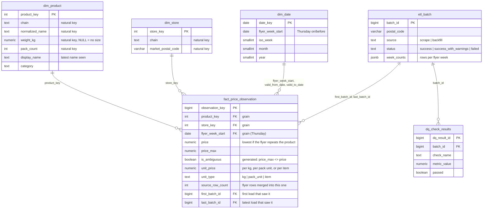

# 🛒 BudgetPlate

**Find the cheapest groceries near you this week — built for Canadian students and budget shoppers without a car.**

BudgetPlate pulls real weekly flyer deals from major Canadian grocery chains, parses them into comparable unit prices, and ranks them by **price per kg _and_ distance**. Every weekly scrape is also kept in a small **price-history warehouse** (star schema, idempotent loads, data-quality checks) — see [Price-history warehouse](#price-history-warehouse). The cheapest store 45 minutes away loses to a slightly pricier one 10 minutes on foot.

**One entry point:** enter your postal code, weekly budget, and household size. BudgetPlate finds the best-value store near you and builds a results page around what's actually on sale this week:

- **Worth buying this week** — an AI-curated weekly shop built from real deals, with simple meal ideas and a shopping list checked against your budget.
- **This week's deals** — the store's full deal list, filterable by keyword.
- **Search a specific item** — a small secondary lookup at the bottom of the page for when you're after one thing in particular.

---

## Tech stack

| Layer        | Tech                                                            |
| ------------ | -------------------------------------------------------------- |
| Backend      | FastAPI (Python)                                              |
| Frontend     | React + Tailwind CSS + Recharts                              |
| AI           | Anthropic Claude Haiku (`anthropic` Python SDK)              |
| Database     | PostgreSQL 15+ (Supabase in prod, local for dev): app tables + a star-schema price-history warehouse |
| Scheduling   | GitHub Actions (prod, weekly) · APScheduler (local dev only) |
| Location     | OpenStreetMap — Nominatim geocoding + Overpass (no API key)  |
| Data source  | [Flipp scraper](https://github.com/Kiizon/flippscrape) (integrated) |
| Deployment   | Render (backend) + Supabase (database) + Vercel (frontend)   |

---

## Project structure

```
budgetplate/
├── backend/
│   ├── main.py                # FastAPI app + middleware + scheduler
│   ├── config.py              # env-driven settings
│   ├── database.py            # psycopg2 pool; init_db() applies migrations
│   ├── migrate.py             # tiny migration runner (schema_migrations table)
│   ├── migrations/            # 000 legacy table · 001 star schema · 002-005
│   ├── queries.py             # shared DB reads (API reads the flyer_items view)
│   ├── activity.py            # which postal codes people actually request
│   ├── backfill.py            # one-off: legacy flyer_items -> first warehouse batches
│   ├── weekly_refresh.py      # weekly scrape+load+DQ (GitHub Actions entry point)
│   ├── scheduler.py           # APScheduler, local dev only (ENABLE_SCHEDULER)
│   ├── rate_limit.py          # per-IP rate limiter middleware
│   ├── analytics/queries.sql  # price-history analytics (4 commented queries)
│   ├── tests/                 # pytest suite (needs a *_test Postgres database)
│   ├── scraper/
│   │   ├── flipp.py           # integrated Flipp scraper (no key needed)
│   │   ├── parser.py          # pure-Python parser: weights, categories, names
│   │   ├── pipeline.py        # scrape → parse → warehouse, with 24h cache
│   │   ├── warehouse.py       # idempotent batch loader (star schema)
│   │   └── dq.py              # data-quality checks after every load
│   ├── ai/
│   │   ├── client.py          # shared Anthropic client + JSON parsing
│   │   ├── search.py          # fuzzy item match + substitutes (pure Python)
│   │   └── budget.py          # weekly basket generation (the only Claude call)
│   ├── location/
│   │   └── stores.py          # Nominatim + Overpass + distance scoring
│   └── routes/                # /api endpoints
├── frontend/
│   └── src/
│       ├── api.js             # API client (never sees the API key)
│       ├── App.jsx            # view router
│       └── components/        # Home, Results, BudgetShop, ItemSearch …
├── .github/workflows/
│   └── weekly-refresh.yml     # prod weekly refresh (Thursday 06:00 Toronto)
├── render.yaml                # Render blueprint
└── README.md
```

---

## Prerequisites

- **Python 3.11** (pinned to 3.11.9 in `backend/.python-version`)
- **Node.js 18+**
- **PostgreSQL 15+** running locally, or a Supabase project (15+ is needed for `UNIQUE NULLS NOT DISTINCT`)
- An **Anthropic API key** ([console.anthropic.com](https://console.anthropic.com))

---

## Backend setup

```bash
cd backend

# 1. Create a virtual environment
python3 -m venv .venv
source .venv/bin/activate      # Windows: .venv\Scripts\activate

# 2. Install dependencies
pip install -r requirements.txt

# 3. Configure environment
cp .env.example .env
#   then edit .env and set:
#     ANTHROPIC_API_KEY=sk-ant-...
#     DATABASE_URL=postgresql://localhost/budgetplate
#     RATE_LIMIT_PER_MINUTE=10

# 4. Create the database (local Postgres)
createdb budgetplate
#   Migrations in migrations/ apply automatically on app startup,
#   or run them yourself: python migrate.py

# 5. Run the API
uvicorn main:app --reload
```

The API runs at **http://localhost:8000**. Interactive docs: **http://localhost:8000/docs**.

> On first request for a postal code, the backend scrapes Flipp and parses the
> items with a pure-Python parser (a few seconds, no AI calls). Results are
> cached for 24h, so subsequent requests are instant.

---

## Frontend setup

```bash
cd frontend

# 1. Install dependencies
npm install

# 2. (optional) configure the API base
cp .env.example .env
#   Leave VITE_API_BASE blank for local dev — Vite proxies /api to :8000.
#   In production, set it to your Render backend URL.

# 3. Run the dev server
npm run dev
```

The app runs at **http://localhost:5173**.

---

## API endpoints

| Method | Path                                                       | Description                                   |
| ------ | ---------------------------------------------------------- | --------------------------------------------- |
| GET    | `/api/health`                                              | Liveness check                                |
| POST   | `/api/scrape`                                              | Trigger scrape for a postal code (24h cache)  |
| GET    | `/api/items?postal_code=V7C4V9&query=chicken+breast`       | Search items, ranked by price-per-kg + distance |
| GET    | `/api/stores?postal_code=V7C4V9`                           | Nearby supported stores with distance + deals  |
| POST   | `/api/budget-plan`                                         | Build a weekly shop from a store's deals       |
| GET    | `/api/deals?postal_code=V7C4V9&merchant=No+Frills`         | All deals at a store this week                 |

Example:

```bash
curl "http://localhost:8000/api/stores?postal_code=M5V3L9"

curl -X POST http://localhost:8000/api/budget-plan \
  -H "Content-Type: application/json" \
  -d '{"postal_code":"M5V3L9","merchant":"No Frills","budget":60,"people":2,"frequency":"Weekly","restrictions":["Vegetarian"],"dislikes":["mushrooms"]}'
```

---

## How it works

### Data pipeline (`backend/scraper/pipeline.py`)

1. Runs the integrated Flipp scraper for a postal code (No Frills, FreshCo, Walmart, Loblaws grocery flyers only).
2. Filters out items with no price.
3. Parses every item with a **pure-Python parser** (`scraper/parser.py`) — no AI calls: regex weight extraction (g/kg/lb/ml/L, ranges like `252/336 g`, count packs like `8's`), per-kg / per-unit pricing, word-boundary keyword categorization, and brand/size-stripped display names. ~1200 items parse in well under a second; the whole pipeline finishes in a few seconds (network time only).
4. Appends the rows to the **price-history warehouse** as a new batch and runs **data-quality checks** (see below). The API reads the latest batch through a `flyer_items` view.
5. **24h cache** — if a postal code was successfully scraped less than a day ago, cached data is returned instead of re-scraping.

**Claude Haiku is only called in `/api/budget-plan`** — to build the weekly basket and meal ideas from the already-parsed deals. Scraping, parsing, and item search are all deterministic Python.

A weekly refresh re-runs the pipeline every **Thursday at 06:00 Toronto time** (flyers run Thursday–Wednesday) for every postal code requested in the last 30 days. In production it runs in **GitHub Actions**; locally, APScheduler can run it. See [Scheduling](#scheduling).

### Store location engine (`backend/location/stores.py`)

- Geocodes the postal code with Nominatim (structured postal-code search), falling back to an FSA-level centroid via the free, keyless [Zippopotam.us](https://zippopotam.us) API — OSM's Canadian postal coverage is patchy, so many valid codes (e.g. much of BC) aren't in Nominatim.
- Queries Overpass for supermarkets, grocery, and convenience stores within 5km (widening to 10km if no supported chain is found), rotating across Overpass mirrors to ride out rate limits.
- Matches store names against the supported chains by case-insensitive substring (`no frills`, `freshco`, `walmart`, `loblaws`, plus `superstore` / `real canadian` → Loblaws).
- Computes walking distance/time (5 km/h) and a walkability band: walkable (<1km), short transit (1–3km), far (3km+).
- Ranks by a composite score blending a per-merchant price index with distance.
- If no supported chain is within 10km, returns **all** nearby grocery stores with a note that deal data is limited to the four supported chains.

### Security

- The **Anthropic API key lives only on the backend** — the frontend calls FastAPI, never Anthropic directly.
- `.env` is git-ignored; `.env.example` documents the required variables.
- A per-IP **rate limiter** caps requests at `RATE_LIMIT_PER_MINUTE`.
- The database is closed to Supabase's auto-generated API; only the backend reads it. See [Locking down Supabase's Data API](#locking-down-supabases-data-api).

---

## Price-history warehouse

Before this, every scrape **deleted and rewrote** a postal code's rows in `flyer_items`, so last week's prices were gone the moment this week's arrived. The warehouse keeps every week instead: each scrape is appended as a **batch**, loads are **idempotent**, and every batch is **data-quality checked**. The live app keeps working unchanged on top of it.

### Schema

The fact table records **one product, at one store-market, in one flyer week**. That sentence (the *grain*) also defines the uniqueness key that makes loads idempotent.



- **`fact_price_observation`**: `UNIQUE (product_key, store_key, flyer_week_start)`. Indexes: `(store_key, flyer_week_start)`, `(flyer_week_start)` and `(last_batch_id)`. The grain's unique index already serves per-product history, so there's no separate product index.
- **`dim_product`**: matched on `chain + normalized_name + weight_kg + pack_count` using `UNIQUE NULLS NOT DISTINCT` (Postgres 15). Without it, a plain `UNIQUE` treats every NULL size as different, so a product with no size would be duplicated every week.
- **`dim_store`**: a **chain within a postal-code market**, not a physical store. Flipp serves flyers per postal code, not per location (physical stores come from OpenStreetMap separately).
- **`dim_date`**: one row per day from 2020 to 2035. `flyer_week_start` is the **Thursday** on or before the date: all 3,110 rows scraped before the warehouse started on a Thursday, so flyers run Thursday to Wednesday. The same dimension plays three roles: flyer week, valid-from and valid-to.
- **`etl_batch`**: append-only audit log of every load attempt, including failures. It records row accounting (raw → priced → usable → loaded, inserted vs refreshed, duplicates collapsed) and per-category, per-chain and per-week snapshots that DQ compares against.

### Why a star schema

Every question asked of this data has the same shape: *a price, sliced by product, by store and by week.* That's the textbook dimensional model.

- **Facts stay narrow:** numbers and foreign keys. Descriptive text (names, categories) lives once in a dimension instead of being repeated in every weekly row.
- **One declared grain** gives an obvious idempotency key and makes double-counting easy to reason about.
- **Fewer joins than a normalized model, and less duplication than one wide flat table.** Fixing a product's name or category is a one-row update.
- **Snowflaking isn't worth it at this size.**

The trade-off is that products are **chain-scoped**, so the same item at two chains is two rows. Cross-chain comparisons go through `normalized_name`.

### How a load works (`scraper/warehouse.py`)

1. **Open a batch.** An `etl_batch` row is committed on its own first, so a load that fails later still leaves a `failed` row with the error.
2. **Prepare rows.**
   - Rows with no positive price or no `valid_from` are dropped and counted.
   - Each row is assigned its flyer week from the flyer's own local date.
   - Rows whose dates end before they start are kept but counted, for DQ.
3. **Collapse duplicates.** Flipp really does list the same product several times in one flyer (a real Walmart flyer has "Halloween plush" five times: 3× $8.48 and 2× $26.98). Rows that share a grain key merge into one fact:
   - `price` is the lowest;
   - `price_max` is the highest;
   - `source_row_count` records how many merged;
   - `is_ambiguous` flags different prices (likely variants under one name).
4. **Upsert, in one transaction, under a per-market advisory lock.** Dimensions are upserted first; descriptive attributes follow the newest week, so loading an old batch can't overwrite them. Then facts are written with `INSERT … ON CONFLICT (grain) DO UPDATE`:
   - `first_batch_id` never changes;
   - `last_batch_id` moves forward;
   - `RETURNING (xmax = 0)` counts new rows vs refreshed rows.
5. **Run DQ checks** after commit (below).

**Idempotency on real data:** running the same Toronto scrape twice gave batch 3 *861 new*, then batch 4 *0 new, 861 refreshed*. The second batch is in the audit log, but the fact table holds 861 rows, not 1,722.

### The `flyer_items` view (keeping the live app working)

Migration 003 renames the old table to `flyer_items_legacy` (nothing is dropped) and creates a **view called `flyer_items`** with the same 13 columns. `queries.py` and the routes didn't change.

For each postal code, the view returns the rows from that postal code's **most relevant successful batch**: newest flyer week first, then most recently finished.

- That reproduces the old table's "one scrape per postal code" behaviour.
- It avoids double-counting a product across weeks.
- It stops a backfill of July data, run today, from hiding today's flyer.

| | View (chosen) | Keep writing both a table and the warehouse |
|---|---|---|
| Source of truth | One | Two that can drift apart |
| Storage | No duplication | Every row stored twice |
| API reads | 3-table join (indexed, ~1k rows per postal code: a few ms) | Single table |
| Risk | The view must keep the exact column contract (covered by tests) | Lowest risk to the app |

The 24h cache now reads `etl_batch` and only counts **scrape** batches that loaded rows. Neither a backfill nor an empty Flipp response stops the app from scraping the current flyer.

### Locking down Supabase's Data API

Supabase publishes every table and view in the `public` schema as a REST API (PostgREST). Anyone holding the project's **anon key** can call it, and that key is designed to be public, embedded in frontends. BudgetPlate never uses this API: the browser talks to FastAPI, and FastAPI connects with `DATABASE_URL` as the role that **owns** the tables. Supabase's security advisor flagged the gap (`public.flyer_items`: RLS not enabled), so migration `005_lock_down_data_api.sql` closes the API in three layers. Any one of them blocks it on its own.

| Layer | What it does | Why the backend is unaffected |
|---|---|---|
| **RLS on every table, with no policies** | Any role that isn't the owner sees **zero rows** | Table owners bypass RLS, and it is deliberately not `FORCE`d |
| **`flyer_items` view with `security_invoker = true`** | The view checks the *caller's* rights and RLS | The backend owns the base tables either way |
| **Revoke `anon` and `authenticated`**, for existing tables, views and sequences, and through default privileges for tables created later | API requests fail with `permission denied` before RLS is consulted | The owner's own privileges are untouched |

Why the view layer matters: a Postgres view normally runs with its **owner's** privileges. Without `security_invoker`, an `anon` request to `/rest/v1/flyer_items` would read the tables *as the owner*, and RLS on those tables would never apply.

On local Postgres the `anon` and `authenticated` roles don't exist, so the revoke step is skipped and the migration only enables RLS and sets the view option.

`tests/test_data_api_lockdown.py` recreates Supabase's setup inside the test database: `anon` and `authenticated` with the grants a new project gives them, plus a **non-superuser** table owner standing in for Supabase's `postgres` role. Testing as the local superuser would prove nothing, because superusers skip RLS. The tests check four things:

- the backend's own connection pool, running as that owner, still loads batches and reads `flyer_items` through `queries.py`;
- both API roles are denied every table and the view;
- if `SELECT` is granted again by mistake, RLS still returns zero rows, and switching `security_invoker` off would leak them;
- a table created later isn't exposed.

Limits of this layer:

- **Every new table needs `ENABLE ROW LEVEL SECURITY` in its migration.** A test fails if any table in `public` lacks it.
- **Default privileges only cover objects created by the role that ran the migration** (`postgres`). Tables created in the Supabase dashboard as another role would need the same treatment.
- **`service_role` keeps full access by design** (it bypasses RLS). Its key must never leave the server; BudgetPlate doesn't use it.
- **An "RLS enabled, no policy" notice in the security advisor is expected.** That is the intended state. For extra assurance you can also turn off the Data API, or stop exposing `public`, under Project Settings → Data API.

### Data-quality checks (`scraper/dq.py`)

Seven checks run after every load. Each writes a row to `dq_check_results`. Each check is a pure function of two batch snapshots (this batch and the previous one for the same postal code), so they're unit-tested without a database.

**Failures are warnings:** the batch is marked `success_with_warnings`, a warning is logged, and the data stays loaded. A crashing check never fails a load.

| Check | Fails when | Observed on real batches |
|---|---|---|
| `row_count_vs_previous` | rows in the **dominant flyer week** drop > 40% | −5% to +5% |
| `chain_coverage_vs_previous` | a chain from the previous batch is missing | Loblaws vanished from one market's October scrape |
| `missing_or_zero_price_pct` | > 20% of scraped rows have no or zero price | 9.3–10.4% (gift cards, "see in store" items) |
| `missing_weight_unit_pct` | > 75% of rows have no weight and no pack count | 43–64% (produce, items sold each) |
| `category_distribution_shift` | total variation distance > 0.15 | 0.035–0.065 |
| `duplicate_keys_in_batch` | > 35% of rows collapsed as duplicates | 11–20% (a flyer fetched twice would be ~50%) |
| `invalid_validity_window` | any row with `valid_to < valid_from` | 1 real row in the July data |

Notes on calibration:

- **Thresholds came from measured data, not guesses.** A 2% missing-price limit would have failed every live scrape.
- **Row count compares dominant weeks, not batch totals.** One July scrape held two full flyer weeks at once (next week's flyer was already published), and comparing totals would raise a false −53% alarm.

Real results from building this, across 28 checks on 4 batches: **27 passed**. The one failure was that real inverted date row. Comparing the Toronto October batch with its July baseline:

- rows: **+2.3%**
- category shift: **0.055**
- duplicates: **15.4%**, led by "Halloween Plush" with 5 listings

### Analytics (`backend/analytics/queries.sql`)

Four plain-SQL queries, each commented with the business question it answers:

| Query | Question |
|---|---|
| `q1_chain_discount_frequency` | Which chain discounts most often (≥ 5% below a product's usual price)? |
| `q2_week_over_week_common_items` | How did chicken, eggs and rice prices change since each product was last advertised? |
| `q3_share_of_real_deals` | What share of this week's "deals" are actually below the product's usual price? Point-in-time: judged only against earlier weeks. |
| `q4_category_price_trends` | Median price per kg by category, market and week. |

```bash
psql "$DATABASE_URL" -f backend/analytics/queries.sql
```

Two rules apply across the queries:

- **Ambiguous rows** (one name, several prices in one week) are excluded from Q2, as specified. They're also excluded from Q1 and Q3, where a cheaper variant would look like a discount.
- **Q4 keeps ambiguous rows,** because a median over many products isn't moved by a few.

### Scheduling

Flyers go live on **Thursday**, so the refresh runs **Thursday 06:00 America/Toronto** for every postal code requested in the last 30 days. Demand is recorded by `/api/stores` in `postal_code_activity`. It used to be "scraped in the last 30 days", which let the refresh keep its own postal codes active forever.

**Production: GitHub Actions** (`.github/workflows/weekly-refresh.yml`)

- Runs `python weekly_refresh.py` and connects through the **`DATABASE_URL` repository secret**.
- GitHub cron only runs in UTC, and 06:00 Toronto is 10:00 UTC in summer (EDT) but 11:00 UTC in winter (EST). The workflow therefore registers **both** crons, and `weekly_refresh.should_run_scheduled()` lets through only the one that equals 06:00 Toronto that day; the other exits before touching the database.
- The DST check looks at *which cron fired* (`github.event.schedule`), not the clock, so GitHub's late starts can't cause a skipped or doubled week. Loads are idempotent, so a double run would be harmless anyway.
- **Manual runs:** Actions → *Weekly flyer refresh* → *Run workflow*, with an optional comma-separated `postal_codes` list.
- Each run writes a summary table to the run page. A failed DQ check shows as a **warning annotation** and the job stays green. A load error, or a missing secret, fails the job.
- Hardening: `contents: read` permissions, `persist-credentials: false`, a concurrency group, a 20-minute timeout, and `checkout@v7` / `setup-python@v7` (Node 24).

**Why not Render?** A free Render web service **sleeps after 15 minutes without traffic**, so a scheduler inside the app can't be relied on in production. `render.yaml` sets `ENABLE_SCHEDULER=false` there.

**Local dev: APScheduler** (`scheduler.py`)

- It runs the same `refresh()` code, Thursdays at 06:00 with the timezone set **explicitly**. APScheduler otherwise uses the host's timezone, which is UTC on Render, so the old "6am" job fired at 2am Toronto.
- It only starts when `ENABLE_SCHEDULER=true`. `.env.example` sets that; add it to an existing local `.env` to keep the local job running.

### Running it locally

```bash
cd backend
python migrate.py                  # apply pending migrations (also runs on app startup)
python backfill.py                 # once: load pre-warehouse flyer_items rows (re-runs are skipped)
python weekly_refresh.py M5S1Z9    # scrape + load + DQ one postal code (same path as CI)
psql budgetplate -f analytics/queries.sql

# tests: a disposable database whose name must contain "test"
createdb budgetplate_test
pip install -r requirements-dev.txt
pytest                             # 96 tests
```

### Backfill

`backfill.py` turned the 3,110 rows left in the pre-warehouse table into the first batches: M5S1Z9 → 842 facts and V7C4K2 → 1,906 facts across 3 flyer weeks. Two details matter:

- **It re-parses rather than copying.** Those rows were cleaned by an earlier parser, and today's parser disagrees on 43% of names and 33% of categories. Copying them would stop July products from matching their October rows. Only the raw inputs (original name, price, dates) are kept.
- **Timestamps are read back in Eastern time.** The old columns had no timezone, and Postgres silently drops the offset from a value like `…T03:00:00-04:00`. A live scrape showed that Flipp reports every market in Eastern time: BC flyers start at `03:00-04:00`, which is midnight Pacific.

### Storage growth

Measured on the real warehouse (3,609 facts):

- **Facts: 375 B per row** and **products: 394 B per row**, including indexes.
- Products are rarely reused across weeks today (see limitations), so the warehouse adds about **0.9 product rows per fact**, roughly **730 B per fact** in total.
- A postal code's weekly flyer is **612–1,001 facts** (live October scrapes), about **0.7 MB per postal code per week**.

| Postal codes refreshed | Per year | Supabase free tier (500 MB) lasts |
|---|---|---|
| 1 | ~36 MB | ~13 years |
| 2 | ~73 MB | ~6.5 years |
| 10 | ~365 MB | ~1.3 years |

Fixed overhead is about 2 MB (`dim_date` 0.6 MB, `flyer_items_legacy` 1.1 MB), and `etl_batch` plus `dq_check_results` add about 8 rows per postal code per week. If it gets tight:

- drop `flyer_items_legacy` once the backfill is verified;
- improve product matching, which shrinks `dim_product`;
- or roll weeks older than about two years up into monthly aggregates.

### Known limitations

- **Product matching is strict and still weak.**
  - It needs the same chain, normalized name and size.
  - Only **4.9%** of Toronto's October products matched a July product, and only **7.8%** matched between consecutive weeks in Richmond. Some of that is real (most flyer items rotate weekly), but cleaned names still contain marketing text such as "Selected Varieties", and a renamed item never matches.
  - Next step: strip marketing phrases before normalizing, then try fuzzy or embedding-based matching.
- **Store means market.** Prices are per chain per postal code, not per physical store.
- **Ambiguous rows keep the lowest price.** Variants listed under one name (15 such product-weeks so far) aren't split apart, and they're excluded from Q1–Q3.
- **Q4 mixes price change with product-mix change.** A category's median moves when different products are advertised, not only when prices change (for example, Household +106% week to week). A like-for-like index over products present in both weeks would be cleaner.
- **History is thin.** Flipp only serves current flyers, so history starts with the July backfill and the weeks scraped since. Q1 and Q3 become meaningful after about six weeks.
- **Dates are in Eastern time,** following Flipp. A BC flyer's last valid date can read one day late.
- **Some categories are wrong** because the parser matches keywords: "onions" lands in Other (word boundaries don't match plurals) and "potato chips" lands in Produce.
- **Progress tracking and rate limits are in memory**, so they don't work across multiple instances.

---

## Deployment

Production runs on three free tiers:

- **Render** runs the FastAPI backend.
- **Supabase** hosts Postgres.
- **Vercel** serves the frontend.

GitHub Actions runs the weekly refresh. The backend and the Actions job connect to the same Supabase database through one `DATABASE_URL`.

### Database → Supabase

The database is **not** on Render. Render's free Postgres is deleted 30 days after creation (plus a 14-day grace period), has no backups and is capped at 1 GB. That would wipe the price history, the whole point of the warehouse. Supabase's free tier gives 500 MB and doesn't expire; see [Storage growth](#storage-growth) for how long that lasts.

- **Use the session pooler connection string:** Connect → *Session pooler*, port **5432**, user `postgres.<project-ref>`, with `?sslmode=require` appended.
  - Not the *direct* connection: it is IPv6-only, and neither Render nor GitHub-hosted runners can reach it.
  - Not the *transaction* pooler (port 6543): it drops session state between transactions.
- **Migrations** apply automatically when the backend starts. To apply them by hand (e.g. to watch the output), run `DATABASE_URL="<session pooler URL>" python migrate.py` from `backend/`.
- **The Data API is closed** by migration 005; see [Locking down Supabase's Data API](#locking-down-supabases-data-api).
- **Inactivity pausing:** a free project pauses after about a week without activity. The weekly refresh should count as activity, but check the dashboard after the first quiet week.

### Backend → Render

`render.yaml` defines the web service only. In the Render dashboard:

1. New → Blueprint → select this repo.
2. Set the secrets: `ANTHROPIC_API_KEY`, and `DATABASE_URL` (the Supabase session pooler URL). Both are `sync: false`, so they are entered in the dashboard and never stored in git.
3. Deploy. Pending migrations apply on startup.

The free web service sleeps after 15 idle minutes, so the weekly refresh runs in GitHub Actions, not inside the app (see [Scheduling](#scheduling)).

### Weekly refresh → GitHub Actions

1. Repo → Settings → Secrets and variables → Actions → add `DATABASE_URL`, the same session pooler URL.
2. Actions → *Weekly flyer refresh* → *Run workflow*, with the postal codes you want, to check that it runs. After that it runs every Thursday at 06:00 Toronto.

### Frontend → Vercel

1. Import the repo into Vercel, set the project root to `frontend/`.
2. Set `VITE_API_BASE` to your Render backend URL (e.g. `https://budgetplate-api.onrender.com`).
3. Deploy. `frontend/vercel.json` configures the Vite build.

---

## Notes & limits

- Supported stores: **No Frills, FreshCo, Walmart, Loblaws** (the chains the Flipp scraper covers).
- For educational use; flyer data belongs to Flipp and its partners. Use responsibly and respect rate limits.
- Warehouse-specific limitations are listed under [Known limitations](#known-limitations).
- Phase 2 ideas (not built yet): accounts, saved lists, deal notifications, more stores.
